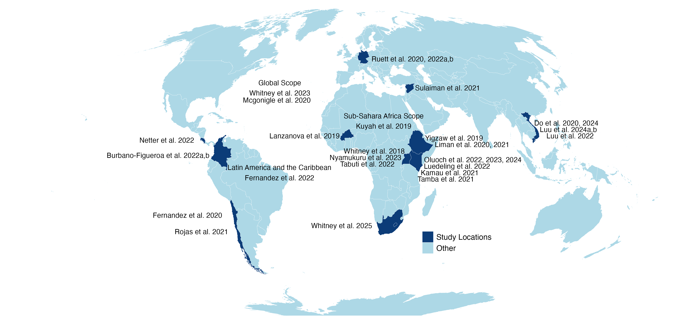
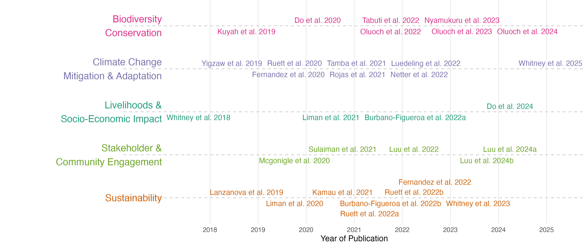

In this thesis, I present a selection of my research papers from the past six years, reflecting an evolving body of work at the intersection of decision analysis and agroecology. While not exhaustive, this collection represents key contributions that advance probabilistic decision-making in complex socio-ecological systems. Each study provides methodological insights into managing uncertainty, integrating expert knowledge, Bayesian reasoning, and participatory approaches to support agricultural and environmental decision-making.

The research included in this thesis spans diverse contexts and landscapes, from evaluating agricultural policies in Uganda [@whitney_probabilistic_2018] [Paper `r get_paper_number("whitney_probabilistic_2018")`](#whitney_probabilistic_2018), to the broader application of probabilistic decision models in agroecological interventions [@whitney_decision_2023] [Paper `r get_paper_number("whitney_decision_2023")`](#whitney_decision_2023) (Fig. \ref{fig:plot_study_locations_map}).

The work outlines ways to balance agricultural productivity with water conservation priorities [@whitney_balancing_2025] [Paper `r get_paper_number("whitney_balancing_2025")`](#whitney_balancing_2025), optimize long-term water resource management [@lanzanova_improving_2019] [Paper `r get_paper_number("lanzanova_improving_2019")`](#lanzanova_improving_2019) and understand trade-offs between food security and environmental sustainability in water management [@yigzaw_stochastic_2019] [Paper `r get_paper_number("yigzaw_stochastic_2019")`](#yigzaw_stochastic_2019), through case studies in South Africa, Burkina Faso and Ethiopia respectively. 

The studies focusing on agroforestry highlight its potential to enhance productivity and sustainability in smallholder farming systems. These include `r group_bibrefs_for_markdown(bibtex_data, "Applications", "Agroforestry")` Papers `r group_paper_numbers(bibtex_data, "Applications", "Agroforestry")`. Papers also outline means of integrating farmer knowledge and expert-elicited probabilities for agroforestry [@do_decision_2020] [Paper `r get_paper_number("do_decision_2020")`](#do_decision_2020). The work also covers community-led agroforestry prioritization and conservation strategies in smallholder systems in Uganda [@tabuti_priority_2022] [Paper `r get_paper_number("tabuti_priority_2022")`](#tabuti_priority_2022). Papers address agroforestry and investment strategies for ecosystem rehabilitation in Kenya [@tamba_stochastic_2021] [Paper `r get_paper_number("tamba_stochastic_2021")`](#tamba_stochastic_2021) and quantify carbon storage in savanna ecosystems in Uganda [@nyamukuru_allometric_2023] [Paper `r get_paper_number("nyamukuru_allometric_2023")`](#nyamukuru_allometric_2023). 

<!-- change page orientation -->

\begin{landscape}


```{r plot_study_locations_map, echo=FALSE, fig.cap="\\label{fig:plot_study_locations_map} Geographical distribution of the research contributions presented in this thesis", out.width='10in', fig.width=16, fig.height=9}

```

\end{landscape}

Several studies in this thesis evaluate agricultural certification schemes and their implications for sustainability and economic resilience. We prioritize interventions in banana plantations balancing climate adaptation, farm productivity, and certification incentives in Latin America and the Caribbean [@fernandez_prioritizing_2022] [Paper `r get_paper_number("fernandez_prioritizing_2022")`](#fernandez_prioritizing_2022) assesses carbon certification for agroforestry projects in Costa Rica [@netter_agroforestry_2022] [Paper `r get_paper_number("netter_agroforestry_2022")`](#netter_agroforestry_2022) and address the challenges of livestock emissions modeling in smallholder farms in Kenya [@luedeling_limitations_2022] [Paper `r get_paper_number("luedeling_limitations_2022")`](#luedeling_limitations_2022).

Beyond certification systems, the work presented also covers horticultural production systems, with studies on economic risk in pest management for diversified farms [@burbano-figueroa_farm-planning_2022] [Paper `r get_paper_number("burbano-figueroa_farm-planning_2022")`](#burbano-figueroa_farm-planning_2022). We assess disease management in ornamental plant production [@ruett_assessing_2022] [Paper `r get_paper_number("ruett_assessing_2022")`](#ruett_assessing_2022) and [@ruett_model-based_2020] [Paper `r get_paper_number("ruett_model-based_2020")`](#ruett_model-based_2020). We assess ways to enhance the climate resilience of deciduous fruit production in Chile [@rojas_adapting_2021] [Paper `r get_paper_number("rojas_adapting_2021")`](#rojas_adapting_2021) and address the prospects of decreasing winter chill for these production systems [@fernandez_prospects_2020] [Paper `r get_paper_number("fernandez_prospects_2020")`](#fernandez_prospects_2020).

The work also covers socio-ecological resilience and traditional ecological knowledge. We assess the cultural, ecological, and nutritional value of wild edible plants in Kenya for conservation strategies that align with Indigenous resource management [@oluoch_integrated_2022] [Paper `r get_paper_number("oluoch_integrated_2022")`](#oluoch_integrated_2022) and [@oluoch_predicted_2024] [Paper `r get_paper_number("oluoch_predicted_2024")`](#oluoch_predicted_2024). We study the cultural dimensions of agroecology and resource use of Yerba Maté in Syria [@sulaiman_socio-cultural_2021] [Paper `r get_paper_number("sulaiman_socio-cultural_2021")`](#sulaiman_socio-cultural_2021). 

The work outlines the development of transdisciplinary decision-making frameworks that facilitate collaboration between researchers, policymakers, and practitioners. The approaches support science-policy integration and multi-stakeholder decision-making [@mcgonigle_knowledge_2020] [Paper `r get_paper_number("mcgonigle_knowledge_2020")`](#mcgonigle_knowledge_2020). We applied a holistic sustainability assessment to evaluate the long-term viability of organic and conventional farming in Kenyan smallholder farming systems [@kamau_holistic_2021] [Paper `r get_paper_number("kamau_holistic_2021")`](#kamau_holistic_2021). The work includes climate services and stakeholder-inclusive approaches `r group_bibrefs_for_markdown(bibtex_data, "Applications", c("ClimateServices"))` Papers `r group_paper_numbers(bibtex_data, "Applications", "ClimateServices")`, that address the scaling of agro-climate services, emphasizing collaborative planning for sustainable outcomes.

Several papers delve into biodiversity conservation and ecological sustainability. Studies such as `r group_bibrefs_for_markdown(bibtex_data, "ThematicAreas", "Biodiversity Conservation")` Papers `r group_paper_numbers(bibtex_data, "ThematicAreas", "Biodiversity Conservation")`, explore themes like wild edible plants, habitat restoration, and species prioritization in Sub-Saharan Africa, showcasing the integration of local knowledge with empirical modeling (Fig. \ref{fig:plot_thematic_areas}).

<!-- change page orientation -->

\begin{landscape}


```{r plot_thematic_areas, echo=FALSE, fig.cap="\\label{fig:plot_thematic_areas}Thematic areas of the research contributions presented in this thesis", out.width='100%'}

```

\end{landscape}
