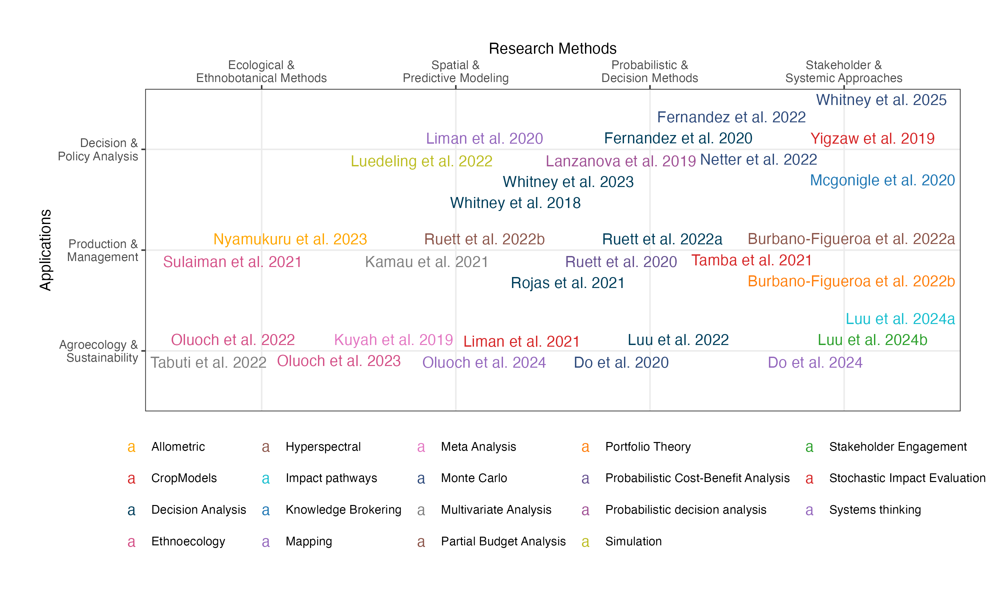

This habilitation advances decision analysis in agroecology by developing probabilistic models, identifying systemic leverage points, and integrating participatory methods to improve decision-making under uncertainty. It demonstrates applications across agroforestry, hydrology, certification schemes, biodiversity conservation, and climate services. By bridging probabilistic modeling, decision science, and transdisciplinary research, the work supports sustainability transformations. It clarifies complex decision environments and applies structured decision-support tools to optimize land use, balance productivity with conservation, and integrate diverse knowledge systems.

The habilitation is structured into two sections: the first advances decision analytical methods in agroecology, while the second contributes to methodological innovations in transdisciplinary research. These sections draw on published studies employing structured decision models, probabilistic analysis, and participatory methods to address key challenges in sustainable agriculture.

The first section, ["Advancing Agroecology through Decision Analytical Methods,"](#chapter_one) explores how decision analysis supports agroecological interventions by addressing complexity, uncertainty, and trade-offs. Studies apply structured decision models across domains such as agroforestry, horticulture, water management, and climate adaptation. By incorporating probabilistic reasoning and expert-elicited knowledge, these models offer robust frameworks for evaluating interventions. In agroforestry, decision models navigate ecological and socio-economic trade-offs, guiding land-use decisions that balance productivity and sustainability. In horticulture, they assess management strategies under resource constraints and market fluctuations. Water management applications integrate climate projections, hydrological data, and stakeholder input to optimize resource allocation. As climate change reshapes agricultural landscapes, decision analysis provides critical tools for adaptation, mitigation, and cost-effective intervention.

The second section, ["Advancing Methods in Transdisciplinarity and Agroecology,"](#chapter_two) highlights methodological innovations that connect agroecology with transdisciplinary research. It emphasizes participatory approaches, stakeholder engagement, and holistic evaluation frameworks that support knowledge co-creation and agroecological innovation. These methods integrate scientific research with local knowledge, foster cross-disciplinary collaboration, and tailor interventions to community needs. The legitimacy and effectiveness of agroecological practices is enhanced by involving stakeholders in decision-making, ensuring research aligns with practical realities. Holistic evaluation frameworks extend beyond cost-benefit analyses, incorporating environmental, social, and economic dimensions for a comprehensive sustainability assessment. Bridging science, policy, and practice remains critical for translating research into meaningful policy outcomes and tangible community benefits.

Together, these sections provide a foundation for advancing decision analytical methods in agroecology while contributing to broader methodological debates in transdisciplinary research. Through structured models, probabilistic reasoning, and participatory approaches, this work demonstrates how scientific rigor and practical application can address complex sustainability challenges. Figure \ref{fig:scatter_plot_applications_methods} illustrates the connection between theoretical and applied dimensions, highlighting the role of decision analysis in agroecological transitions across scales and contexts.

\begin{landscape}

```{r scatter_plot_applications_methods, echo=FALSE, fig.cap="\\label{fig:scatter_plot_applications_methods}Distribution of research contributions across methods and applications. The x-axis categorizes research methods, y-axis represents application areas, color-coded legend identifies the specific methodologies employed in each study.", out.width='100%'}

```

\end{landscape}


