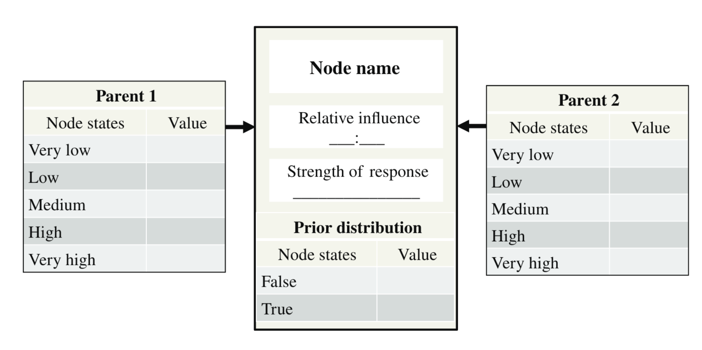
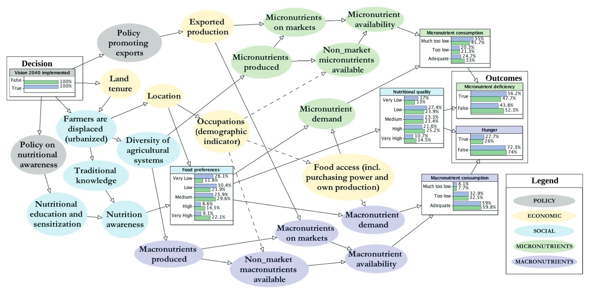
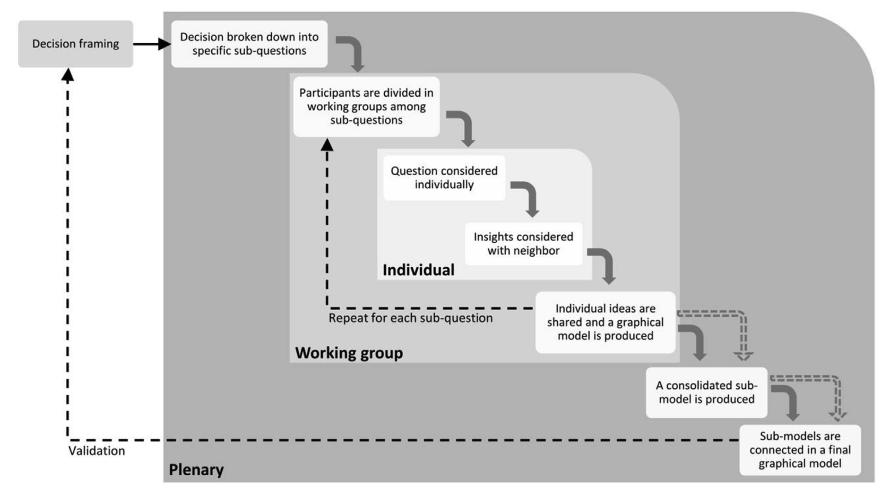

In @whitney_probabilistic_2018 [Paper `r get_paper_number("whitney_probabilistic_2018")`](#whitney_probabilistic_2018), my co-authors and I explored the application of structured decision analysis for supporting interventions to agroecological systems. By employing probabilistic modeling, we demonstrated how these tools could optimize outcomes across multiple dimensions, including ecological conservation, economic resilience, and human well-being. This work highlighted the value of integrating diverse data sources and stakeholder inputs into decision models, ensuring that the solutions are both scientifically robust and contextually relevant. The work defined and demonstrated a set of methods for working with expert groups to define causal model structures for development decisions (Fig. \ref{fig:workshop_model_development}). 

```{r Figures/workshop_model_development, echo=FALSE, fig.cap="\\label{fig:Figures/workshop_model_development}Process used for eliciting graphical representations of decisions from expert groups (Whitney et al. 2018).", out.width='60%'}
knitr::include_graphics('figures/workshop_model_development.pdf')
```

To simplify the task of constructing Bayesian Networks from these causal models we also designed innovative ways to fill the often very complex conditional probability tables with expert elicited probabilities. We used a likelihood method to elicit influence weights rather than whole tables of probabilities. We asked experts to provide a typical distribution of each variable as well as the response and a weighting factor for each state of the child node and each state of the parent nodes (Fig. \ref{fig:node_states_cpts}).

```{r node_states_cpts, echo=FALSE, fig.cap="\\label{fig:node_states_cpts}Tool for expert-informed Conditional Probability Table (CPT) for use in a Bayesian Network (Whitney et al. 2018).", out.width='80%'}

```

In @whitney_probabilistic_2018, we explored the application of the resulting Bayesian Networks as a decision-support tool for agricultural policy analysis (Fig. \ref{fig:vision_2040_bn}). This study focused on Uganda's Vision 2040, an ambitious development strategy aimed at transforming the country's agricultural landscape from subsistence farming to large-scale commercial agriculture. While this vision promised economic growth, its potential impacts on rural livelihoods and household nutrition were largely uncertain.

\begin{landscape}

```{r vision_2040_bn, echo=FALSE, fig.cap="\\label{fig:vision_2040_bn}Bayesian Network (BN) for impact of Vision 2040 on household nutrition in Uganda. (Whitney et al. 2018)", out.width='100%'}

```

In Figure \ref{fig:vision_2040_bn} probabilities are shown (boxes) for outcome variables and variables with the highest value of information. Green bars show the probabilities for the node states for the scenario that the Vision 2040 decision is not implemented (“Vision 2040 false”), and blue bars show probabilities for the scenario that the Vision 2040 decision is implemented (“Vision 2040 true”)

\end{landscape}

We modeled the causal pathways between agricultural interventions and their nutritional outcomes. By integrating empirical data with expert knowledge, we were able to quantify the probabilities of various outcomes, providing a nuanced understanding of the trade-offs inherent in Uganda's agricultural transformation strategy. This approach allowed us to explore critical questions, such as how shifts in land use and farming practices might affect household access to nutritious foods and the prevalence of micronutrient deficiencies. 

A key innovation in this work was the ability to represent complex interdependencies within agricultural systems. This study linked policy interventions to nutrition outcomes, emphasizing stochastic modeling's role in identifying trade-offs and mitigating unintended consequences. For instance, while Vision 2040 aimed to boost economic productivity through large-scale farming, our model revealed potential risks, including reduced access to diverse and nutrient-rich foods for rural households. The results suggested that the policy could inadvertently exacerbate micronutrient deficiencies, even as it achieved its economic objectives.

By performing sensitivity analysis, we identified the factors with the greatest influence on nutritional outcomes, such as dietary diversity and market access. Additionally, the use of value of information (VOI) analysis highlighted areas where targeted data collection could significantly improve decision-making. These insights provided a roadmap for policymakers to mitigate negative outcomes while pursuing development goals (Fig. \ref{fig:vision_2040_voi}).

```{r vision_2040_voi, echo=FALSE, results='asis', fig.pos = "H", out.extra = ""}
cat("
\\begin{figure}[h]
  \\centering
  \\begin{minipage}{0.6\\textwidth}
    \\includegraphics[width=\\textwidth]{figures/vision_2040_voi.png}
  \\end{minipage}%
  \\begin{minipage}{0.35\\textwidth}
    \\caption{\\label{fig:vision_2040_voi}Sensitivity analysis of a Bayesian Network for the probability of household micronutrient deficiency within 10 years of the implementation of Uganda's Vision 2040 (Whitney et al. 2018).}
  \\end{minipage}
\\end{figure}
")
```

A key contribution of my research has been the development and application of decision analysis frameworks tailored to the complexities of agroecological systems. Unlike conventional models that prioritize narrow objectives, such as maximizing crop yield, my work adopts a systems-level perspective. In @whitney_probabilistic_2018, I demonstrated how probabilistic decision tools could evaluate the trade-offs of Uganda’s Vision 2040 policy, revealing unintended consequences on rural livelihoods. This study underscores the value of integrating diverse information sources, stakeholder knowledge, and probabilistic methods to guide decision-making around development interventions. 

Building on this, we extended probabilistic decision analysis to reservoir sedimentation management in Burkina Faso [@lanzanova_improving_2019]. Using Monte Carlo simulations, the study evaluated interventions aimed at mitigating sedimentation risks, identifying the most effective strategies for maintaining agricultural water storage capacity (Fig. \ref{fig:lanzanov_protocol}). 

\begin{landscape}

```{r lanzanov_protocol, echo=FALSE, fig.cap="\\label{fig:lanzanov_protocol}Diagram of a four-stage protocol for eliciting expert knowledge for sedimentation risk reduction in Burkina Faso (Lanzanova et al. 2019)", out.width='100%'}

```

\end{landscape}

Expanding methods for decision structuring and model development (Fig. \ref{fig:lanzanov_protocol}), the analysis combined Monte Carlo simulation, Partial Least Squares regression, and Value of Information analysis to quantify intervention trade-offs. The study demonstrated how probabilistic modeling supports robust decision-making under uncertainty, showing that a combination of dredging, rock dams, and buffer schemes offers the highest probability of sustaining agricultural production [@lanzanova_improving_2019] [Paper `r get_paper_number("lanzanova_improving_2019")`](#lanzanova_improving_2019). 

Further expanding on stochastic modeling, @yigzaw_stochastic_2019 applied Stochastic Impact Evaluation (SIE) to assess the feasibility of irrigation dams in Tigray, Ethiopia. The study incorporated expert-elicited probabilities within a probabilistic decision framework, evaluating potential benefits, costs, and risks of large-scale irrigation investments. Our application of these methods provided probabilistic estimates of hydrological, economic, and environmental trade-offs, supporting climate-resilient water management strategies. One of the key innovations in the work is the structured use of expert knowledge within Monte Carlo simulations and Partial Least Squares analysis, demonstrating how uncertainty quantification enhances decision-support systems. The findings highlight the role of probabilistic modeling in formalizing diverse expert perspectives, revealing trade-offs, and integrating uncertainty into agricultural water management strategies [@yigzaw_stochastic_2019] [Paper `r get_paper_number("yigzaw_stochastic_2019")`](#yigzaw_stochastic_2019). 
