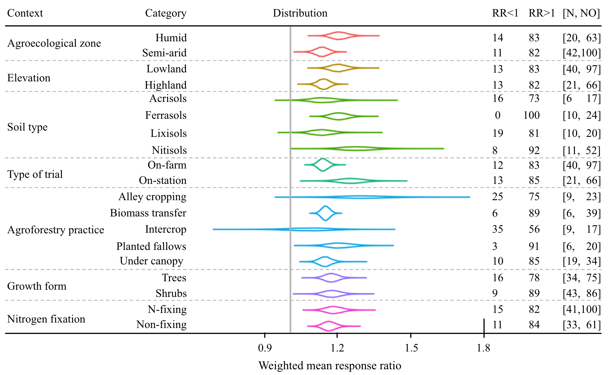
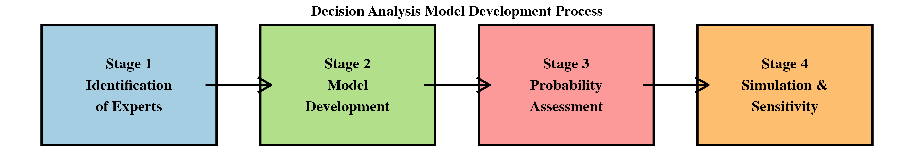
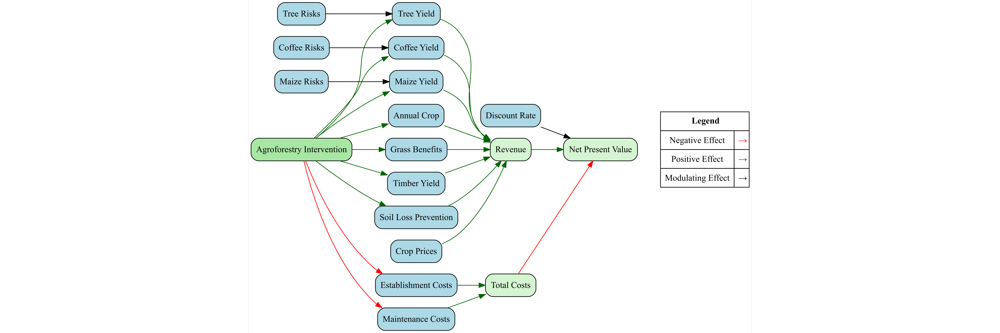
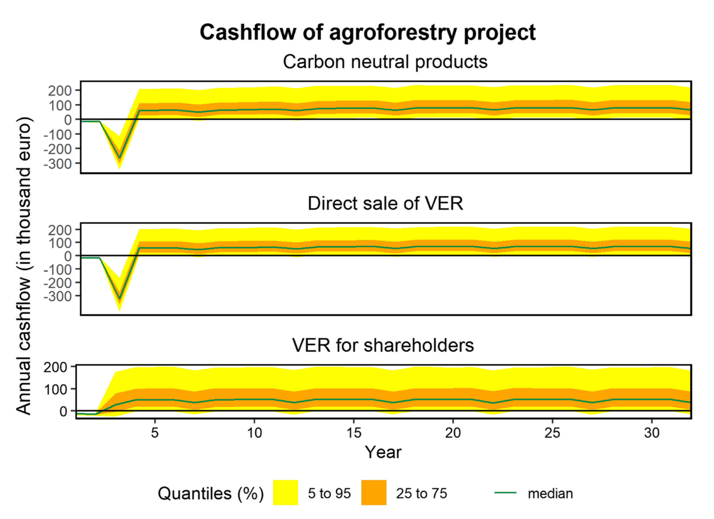

Agroforestry, the deliberate integration of woody perennials into agricultural systems, offers a compelling approach to sustainable agricultural development, particularly in regions facing environmental and socio-economic pressures. By enhancing multiple ecosystem services—including provisioning, regulating, and supporting functions—agroforestry can improve both food security and climate resilience. However, managing agricultural landscapes for sustainability requires balancing trade-offs, as efforts to maximize provisioning services can sometimes diminish regulating and maintenance functions.

Our meta-analysis in @kuyah_agroforestry_2019 demonstrates that agroforestry systems in sub-Saharan Africa can increase crop yields while simultaneously improving soil fertility, reducing erosion, and enhancing water regulation. These systems contribute to higher levels of total soil nitrogen, organic carbon, and phosphorus while mitigating runoff and soil loss. However, these benefits are highly context-dependent, shaped by ecological conditions, management strategies, and species selection. We performed a meta-analysis of agroforestry vs. non-agroforestry effects on provisioning of ecosystem services across sub-Saharan Africa (Fig. \ref{fig:kuyah_agroforestry_violin}). We used bootstrapped t0 values of agroforestry minus non-agroforestry effects. RR < 1 and RR > 1 with (%) observations below or above 1 respectively. Values in brackets indicate the number of studies reviewed (N) and observations (NO). We synthesized evidence of ecosystem service benefits and productivity gains [@kuyah_agroforestry_2019]. Agroforestry increased crop yields, soil nutrients, and water retention while reducing runoff and soil loss.

\begin{landscape}

```{r kuyah_agroforestry_violin, echo=FALSE, fig.cap="\\label{fig:kuyah_agroforestry_violin}Meta-analysis results of agroforestry effects on nitrogen under varied conditions (Kuyah et al. 2019).", out.width='100%'}

```

\end{landscape}

Despite its potential, the widespread adoption and optimization of agroforestry remain constrained by the complexity of these systems and uncertainties surrounding long-term outcomes. Decision-makers, farmers, and policymakers often struggle to assess the risks and benefits of agroforestry interventions, given the delayed returns and variability in performance across different landscapes. To address these challenges, decision-support tools that integrate probabilistic modeling are essential. In @do_decision_2020, we applied decision analysis to model agroforestry interventions aimed at improving livelihoods in Vietnam’s northern highlands. Figure \ref{fig:do_method_agrof_2020} outlines the four stages of decision analysis applied to the case study on agroforestry in Vietnam.

```{r do_method_agrof_2020, echo=FALSE, fig.cap="\\label{fig:do_method_agrof_2020}Outline of four stages of decision analysis applied to a case study on agroforestry in Vietnam (Do et al. 2020).", out.width='100%'}

```

Farmers' preferences for annual monocultures, driven by immediate financial returns, present a major barrier to agroforestry adoption. Our agroforestry models in Vietnam revealed that while monocultures offer short-term profits, they contribute to long-term soil degradation and declining yields. In contrast, agroforestry systems provide substantial long-term benefits, including improved soil fertility and greater resilience to climatic variability. However, their adoption is constrained by high establishment costs, delayed financial returns, and uncertainties in yield stability and market access. These challenges underscore the importance of decision-support tools that can model uncertain outcomes and guide effective policy interventions.

One promising strategy for overcoming these adoption barriers is fruit tree–based agroforestry, which has been promoted in upland Northwest Vietnam as an alternative to staple crop monocultures. While much research has focused on plot-level agroforestry performance, there is limited understanding of how farmers perceive and manage these systems at the whole-farm scale. In @do_adapting_2024, we examined the decision-making processes of agroforestry farmers, identifying key barriers to widespread adoption and the strategies farmers use to navigate management challenges. By integrating farmer perspectives with decision analysis, we highlighted the importance of targeted interventions that align with farmers’ risk perceptions and economic constraints.

Our models captured trade-offs between short- and long-term returns, identifying uncertainties such as time preferences and crop prices. We applied probabilistic methods to assess agroforestry adoption risks, providing smallholder farmers with actionable insights to navigate uncertainties and optimize land-use strategies (Fig. \ref{fig:do_af_model}). Our work integrated probabilistic decision modeling to assess the long-term performance of agroforestry interventions under uncertainty. By simulating multiple agroforestry scenarios, we identified key factors influencing adoption decisions, including financial risks, labor demands, and expected long-term benefits. Our results showed that maize-based agroforestry systems, despite requiring higher initial investments, offered the most resilient and economically viable option for smallholder farmers, while coffee-based systems showed potential for diversification but carried greater uncertainty in returns. This decision-support approach enabled us to quantify trade-offs between short-term risks and long-term benefits, providing actionable insights for policymakers and farmers navigating agroforestry adoption in complex, uncertain environments. 

\begin{landscape}

```{r do_af_model, echo=FALSE, fig.cap="\\label{fig:do_af_model}Conceptual cost-benefit analysis for agroforestry in Northwest Vietnam. “Tree yield” indicates Shan tea harvest, son tra fruits, longan fruits, mango fruits, plum fruits, and macadamia nuts (Do et al. 2020).", out.width='100%'}

```

Figure \ref{fig:do_af_model} illustrates the conceptual cost-benefit analysis framework applied to agroforestry systems in Northwest Vietnam. It visually represents the trade-offs between different agroforestry strategies, highlighting the role of yield variability, investment costs, and long-term financial returns. By incorporating expert-elicited probabilities and Monte Carlo simulations, the model accounts for uncertainties in crop yields, labor demands, and market fluctuations. This visualization supports our probabilistic assessment by clarifying the relative economic viability of different agroforestry configurations, helping stakeholders evaluate the risks and benefits of various land-use decisions.
\end{landscape} 

Beyond Vietnam, agroforestry is increasingly recognized as a sustainable alternative to monocultures in development contexts, offering solutions to food insecurity, soil degradation, and climate adaptation. However, the success of agroforestry depends on a nuanced understanding of tree-crop-environment interactions and their context-specific implications for ecosystem service provision. Woody perennials support billions of people worldwide, yet their establishment, management, and use vary significantly across regions. In @tabuti_priority_2022, we examined the diversity, uses, and cultural significance of woody species in agroforestry, identifying the values that drive farmers and communities to maintain and protect these plants. This research highlights the need for locally adapted agroforestry strategies that align ecological benefits with social and economic priorities. 

Voluntary standards play a critical role in ensuring the integrity of carbon offset projects, including those in agroforestry, by regulating the sale of carbon certificates. However, managers of these projects face significant uncertainties regarding the costs, risks, and financial viability of certification. In @netter_agroforestry_2022, we applied Decision Analysis to evaluate the investment potential of carbon certificates in agroforestry, using Monte Carlo simulations to forecast financial outcomes under different marketing strategies. Our findings revealed that while certification can enhance long-term returns, the financial feasibility of carbon offset agroforestry projects depends on market conditions, pricing strategies, and risk tolerance (Fig. \ref{fig:netter_cashflow}). 

Figure \ref{fig:netter_cashflow} shows the results of an ex-ante analysis of the decision to certify an agroforestry site in Costa Rica with a voluntary carbon offset label, with three marketing strategies: (1) Sale of carbon-neutral products, (2) Direct sale of Verified Emission Reductions (VER), (3) Pass VER on to company shareholders. Plots show the projected probability distributions of the annual cash flows

```{r netter_cashflow, echo=FALSE, fig.cap="\\label{fig:netter_cashflow}Cash flow outputs of a Monte Carlo simulation (with 10,000 model runs) (Netter et al. 2022)", out.width='80%'}

```

More broadly, probabilistic modeling provides a powerful framework for navigating the uncertainties inherent in agroforestry systems. By integrating expert knowledge, empirical data, and scenario analysis, these models enable ex-ante assessments of agroforestry interventions, highlighting key uncertainties and trade-offs that influence adoption decisions. Our research demonstrates how decision-support tools can reduce knowledge gaps, provide plausible outcome ranges, and enhance the design of targeted, risk-aware interventions.

Beyond individual projects, my work in agroforestry research bridges scientific insights with actionable policy, ensuring that interventions are both ecologically sound and economically viable. By applying probabilistic models to agroforestry decision-making, we have developed tools that empower farmers, policymakers, and development practitioners to make informed choices. These contributions illustrate how integrating agroforestry with advanced decision-support approaches can provide a scalable, sustainable pathway for agricultural transformation—one that balances human well-being with ecological resilience.

