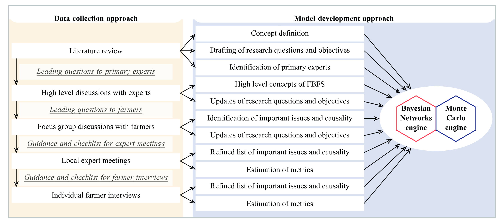
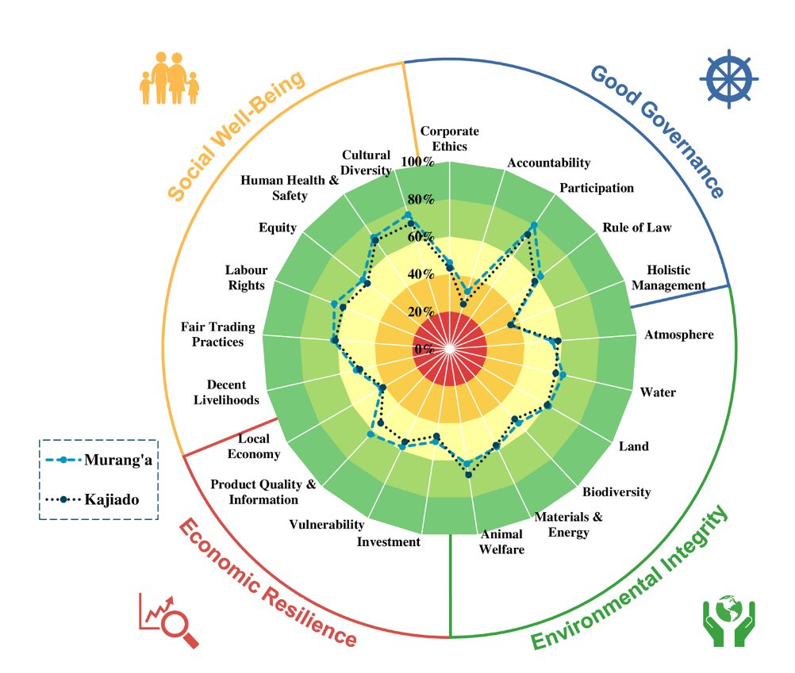

Horticultural production faces numerous uncertainties, from climate variability and pest pressures to market fluctuations and resource constraints. Effective decision-making in this sector requires tools that can account for these complexities and provide robust, scientific insights. Probabilistic decision models offer a powerful approach to quantify risks, assess trade-offs, and optimize management strategies. My research applies Bayesian networks, Monte Carlo simulations, and expert-driven modeling to support horticultural decision-making, enabling growers, researchers, and policymakers to navigate uncertainty and design more resilient and sustainable horticultural systems.

Advancing horticultural production requires data-driven decision-support tools that can account for variability in crop performance, resource availability, and environmental conditions. In my research, I have applied probabilistic modeling, hyperspectral imaging, and model-based assessments to optimize horticultural management, integrating uncertainty analysis and precision agriculture techniques to improve outcomes.

Hyperspectral imaging has emerged as a powerful tool for monitoring plant health, detecting stress factors, and optimizing resource use in horticultural systems. In @ruett_assessing_2022 and @ruett_hyperspectral_2022, we applied high-resolution spectral data and model-based assessments to quantify plant traits and assess crop performance. These studies demonstrated how remote sensing combined with decision modeling can provide real-time, non-destructive monitoring of horticultural crops, improving early detection of nutrient deficiencies and disease stress.

Beyond monitoring, probabilistic decision models offer a structured approach to optimizing horticultural management under uncertainty. In @ruett_model-based_2020, we developed stochastic models to simulate resource allocation, yield variability, and economic trade-offs, helping to guide strategic decision-making. 

Crop models can support agricultural decisions, yet their reliability is necessarily limited when they do not sufficiently represent the complexity and specific circumstances of the target system. In some cases, models have such prohibitively high data requirements that they are only applicable with far-reaching and often questionable assumptions. In @liman_harou_crop_2021, we demonstrate a customizable solution-oriented approach for crop modelling in situations where data and resources are limited (Fig. \ref{fig:liman_protocol_bayes}).

```{r liman_protocol_bayes, echo=FALSE, fig.cap="\\label{fig:liman_protocol_bayes}Approach for developing a crop model for flood-based farming systems in Ethiopia and Kenya (Liman et al. 2021).", out.width='80%'}

```

A broader holistic decision-analysis framework is essential for addressing the complex, multi-dimensional challenges in horticultural and agricultural systems. In @kamau_holistic_2021, we applied multi-criteria decision analysis and expert-driven probabilistic models to assess farm sustainability across ecological, economic, and social dimensions. Our findings highlight the need for improved sustainability planning and reporting, particularly in farm management practices and farmer support systems. The study revealed no significant differences in overall sustainability performance between farm types, but certified organic farms demonstrated higher economic resilience and environmental integrity due to better training and support. Additionally, regional factors played a crucial role, with farms in Murang’a exhibiting stronger sustainability indicators than those in Kajiado, largely due to differences in land tenure security, conflict resolution mechanisms, and resource conservation strategies. The sustainability performance assessment (Fig. \ref{fig:Kamau_2021}) underscores the value of structured decision frameworks in guiding policy and farm-level interventions to enhance long-term resilience in smallholder agriculture.

```{r Kamau_2021, echo=FALSE, fig.cap="\\label{fig:Kamau_2021}Overall performance in degree of goal achievement (DGA) from the SMART-Farm Tool across four sustainability dimensions and 21 sustainability themes for 400 farms in Kajiado and Murang’a counties in Kenya (Kamau et al. 2021).", out.width='80%'}

```

These innovations illustrate how probabilistic modeling, remote sensing, and decision analysis can enhance horticultural sustainability, enabling more precise, data-driven, and resilient agricultural practices. My work in this area demonstrates how advanced decision-support tools can bridge the gap between scientific insight and practical implementation, equipping growers, policymakers, and researchers with strategic, evidence-based approaches for sustainable horticultural production.
