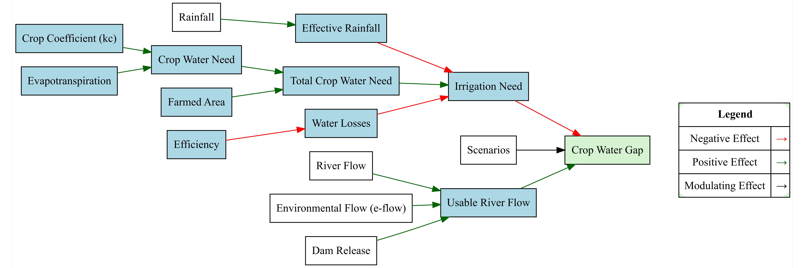
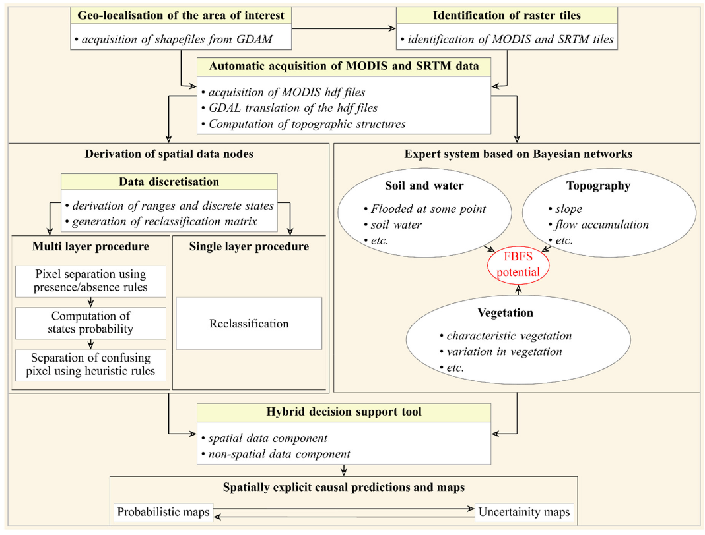

Water availability and hydrological variability play a crucial role in shaping agricultural systems, particularly in regions where seasonal flooding and fluctuating water resources influence farming decisions. Managing these uncertainties requires probabilistic models, remote sensing techniques, and decision-support tools to inform sustainable water use strategies. My research applies stochastic modeling, hydrological analysis, and spatial mapping to improve water resource management, with a focus on flood-based farming systems, water allocation trade-offs, and hydrological forecasting.

In @whitney_balancing_2025, we developed a probabilistic framework for evaluating the trade-offs between agricultural water use and conservation priorities. This model accounts for uncertainties in water availability, demonstrating how decision-support tools can optimize irrigation strategies while balancing environmental and productivity goals. By integrating stochastic hydrological simulations, this approach helps decision-makers navigate competing demands for water resources in agriculture. 

\begin{landscape}

```{r limpopo_model, echo=FALSE, fig.cap="\\label{fig:limpopo_model}Conceptual model illustrating the key components and relationships driving water needs for agriculture and environmental flow (e-flow) management in the Letaba River Basin (Whitney et al. 2025).", out.width='100%'}

```

Figure \ref{fig:limpopo_model} illustrates the key components and interactions influencing water needs in the Letaba River Basin, highlighting the relationships between rainfall, river flow, irrigation demand, and environmental flow (e-flow) management. The model provides a structured approach for assessing the socioecological impacts of e-flow policies on smallholder farming. Our findings indicate that while the irrigation water demand of small-scale agriculture is significantly lower than the required e-flow volume, farmers experience substantial crop water gaps, particularly during dry seasons. These deficits threaten agricultural sustainability and may require upstream water flow supplementation, though this would necessitate restricting current upstream usage. The decision-support framework integrates expert knowledge and Monte Carlo simulations to evaluate e-flow management options under uncertainty. By extending the e-flow concept to include the needs of smallholder farmers, the model equips decision-makers with a robust tool for balancing ecological conservation with agricultural water security, even in data-limited contexts.

\end{landscape}

Spatial uncertainty in flood-based farming systems and land-use planning presents another challenge that deterministic models struggle to address. Traditional remote sensing approaches often misclassify agricultural landscapes due to spectral similarity and system variability. By integrating Bayesian networks with expert-driven probability models, we have developed probabilistic mapping approaches that improve classification and decision-making in dynamic landscapes [@liman_harou_mapping_2020]. 

In @liman_harou_mapping_2020, we applied spatial analysis techniques to map and classify flood-based farming systems, addressing challenges in distinguishing cropping practices influenced by hydrological fluctuations. The study demonstrated that stochastic system behavior and spectral similarities often lead to misclassification in traditional remote sensing approaches. By incorporating advanced classification algorithms and decision-analysis tools, we improved the accuracy of mapping agricultural water use patterns, providing critical insights for land-use planning and flood-adaptive farming systems. We integrated Bayesian networks and remote sensing, enabling probabilistic mapping of flood-based farming systems in Ethiopia and Kenya [@liman_harou_mapping_2020]. Together, these studies illustrate how probabilistic decision models, stochastic hydrological simulations, and remote sensing techniques contribute to a more data-driven, resilient approach to water resource management in agriculture. By quantifying uncertainty and spatial variability, these tools provide a foundation for evidence-based policy and adaptive water management strategies that support both agricultural productivity and environmental sustainability  (Fig. \ref{fig:Liman_Mapping_2020}).

Figure \ref{fig:Liman_Mapping_2020} shows the mixed modeling methods we applied in our work in Kisumu County, Kenya and Tigray region, Ethiopia. Elliptic shapes mark nonspatial data components described by an expert-informed Bayesian network. GADM (Global Administrative Areas), MODIS (Moderate Resolution Imaging Spectroradiometer, SRTM (Shuttle Radar Topography Mission), hdf (Hierarchical Data Format), GDAL (Geospatial Data Abstraction Library), and FBFS (flood-based farming systems) [@liman_harou_mapping_2020]. 

```{r Liman_Mapping_2020, echo=FALSE, fig.cap="\\label{fig:Liman_Mapping_2020}Conceptual framework for probabilistic mapping of flood-based farming systems based on expert analysis (Liman et al. 2020)", out.width='100%'}

```
