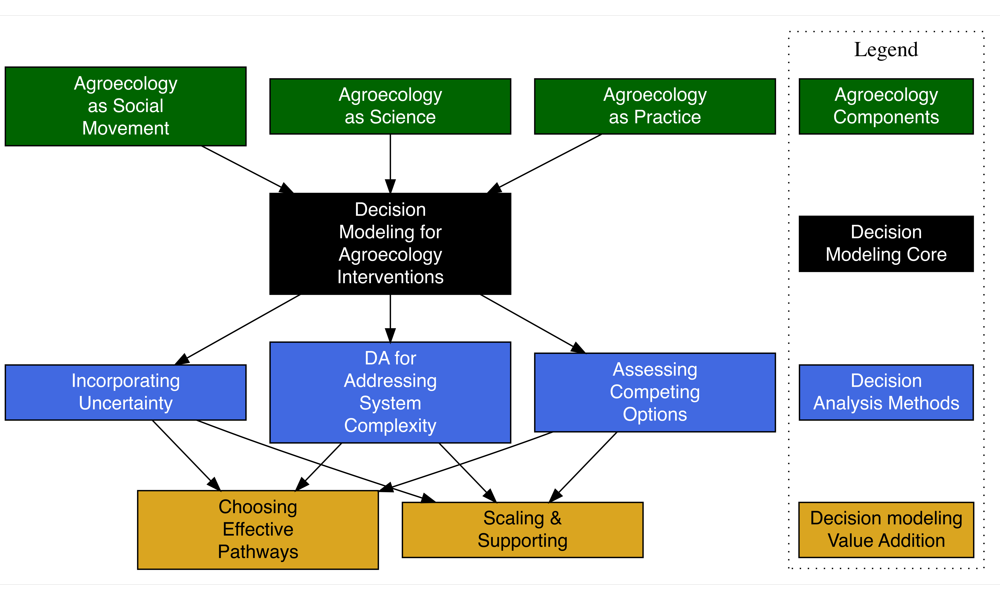

Agroecology is simultaneously a scientific discipline, a movement, and a practice. As a scientific discipline, it applies ecological principles to agricultural systems, developing frameworks and methodologies that enhance sustainability. As a movement, it advocates for food sovereignty, farmer autonomy, and justice, challenging conventional industrial models of production. As a practice, it is rooted in local knowledge, adaptive management, and context-specific solutions that integrate ecological, economic, and social dimensions. Decision-making within agroecology must, therefore, account for the multifaceted and dynamic socio-ecological environment where uncertainty, interdependencies and diverse knowledge systems shape intervention outcomes. Traditional top-down approaches often struggle to address these complexities, leading to interventions that fail to align with the realities of farming communities. In this section of my habilitation I explore how integrating transdisciplinary methods can bridge these gaps to ensure that agroecological transitions are not only scientifically rigorous but also socially equitable and practically viable.

My research moves beyond expert-driven models alone and incorporates participatory frameworks that engage farmers, policymakers, and other stakeholders in structured decision processes. This ensures that interventions are not only scientifically rigorous but also socially and contextually relevant (Fig. \ref{fig:da_agroeco_model}). By engaging with farmers, local communities, and policymakers as active participants in the research process, my work ensures that interventions are co-designed and implemented with those most affected. This approach follows the principle of "nothing about us without us," recognizing that sustainable agricultural solutions must emerge through collaborative processes rather than being imposed externally. Sustainable solutions in agroecology must be co-created with the people who implement them. The following chapters will illustrate how decision-support tools, expert-elicited probabilistic models, and participatory frameworks contribute to agroecology’s evolution as both a scientific approach and a societal transformation and the methodological advancements that support this integration of knowledge. 

In figure \ref{fig:da_agroeco_model} agroecology is represented through its three interconnected dimensions: science, practice, and social movement. Decision modeling serves as the core analytical framework, integrating decision analysis methods to address system complexity, assess competing options, and incorporate uncertainty. The value addition of decision analysis is highlighted through the identification of effective pathways and support for scaling interventions

```{r da_agroeco_model, echo=FALSE, fig.cap="\\label{fig:da_agroeco_model}Conceptual relationships between decision analytical methods and agroecology—overview of how decision analysis methods can support decision-making for agroecology interventions (adapted from Whitney et al., 2023).", out.width='100%'}

```
<!-- \end{landscape} -->

Rather than relying solely on data-driven approaches, my work applies structured decision-support tools, expert-elicited probabilistic models, and participatory methodologies to capture local knowledge and decision constraints. By using Bayesian networks, Monte Carlo simulations and holistic evaluation frameworks, I facilitate decision-making that explicitly accounts for trade-offs, uncertainties, and system interdependencies. This approach has been instrumental in agroforestry adoption, water resource management, biodiversity conservation, and climate adaptation, where structured engagement with local communities enhances the sustainability and scalability of interventions.

The studies presented in this section demonstrate how participatory decision-support frameworks can integrate expert and local knowledge, creating a bridge between science, policy, and practice. For example, stakeholder-driven agro-climate services have been shown to improve the design and adoption of climate adaptation strategies by aligning interventions with farmers' lived experiences. Similarly, decision models applied with smallholder farmers ensure that agroforestry strategies reflect practical realities rather than abstract theoretical constructs.

Recognizing the value of Indigenous and local ecological knowledge, my research also explores ways to integrate traditional farming practices into structured decision models. Indigenous conservation strategies, community-led resource management, and localized agroecological knowledge provide valuable insights that enhance sustainability and resilience. By embedding these perspectives into decision-analytical tools, my work contributes to a more inclusive and effective approach to agroecology.

By emphasizing transdisciplinary collaboration, participatory engagement, and structured decision analysis, this section highlights how agroecological interventions can be more effectively designed and implemented. The following chapters will further explore these themes, demonstrating how integrating diverse knowledge systems leads to more adaptive, resilient, and equitable agricultural transitions.
