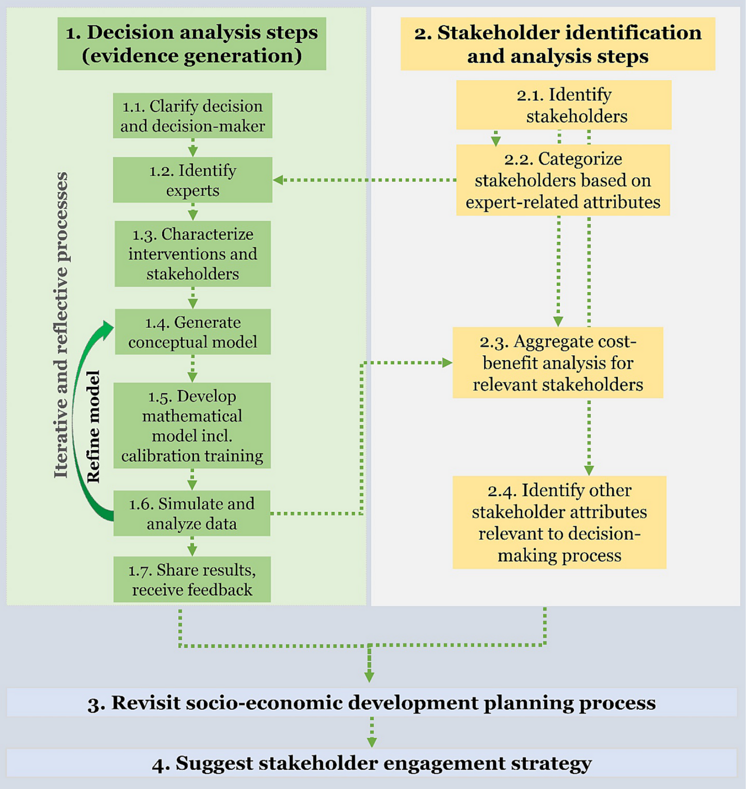

Agroecology requires decision-making frameworks that integrate ecological, economic, and social dimensions while accounting for uncertainty and stakeholder priorities. Conventional models often fail to incorporate expert knowledge and participatory insights, limiting their applicability. My work applies probabilistic decision analysis, Bayesian networks, and participatory modeling to develop structured, expert-driven approaches that enhance agroecological decision-making.

We developed structured decision-support frameworks that integrate ecological, economic, and social dimensions while addressing uncertainty and stakeholder priorities in agroecological decision-making. Conventional models often lack expert knowledge integration and participatory insights, reducing their relevance for complex agricultural systems. To address these gaps, we applied probabilistic decision analysis, Bayesian networks, and participatory modeling to create structured, expert-driven approaches that 

In @mcgonigle_knowledge_2020 we introduced a knowledge brokering framework that bridges scientific research, policy development, and agricultural practice. This framework facilitates landscape-scale decision-making, ensuring that scientific insights are effectively translated into practical agroecological policies. We outline a process for collaboration among researchers, policymakers, and practitioners, improving stakeholder engagement, decision clarity, and the integration of agroecological principles. By categorizing policy levers and interventions, we outlined decision stages within the policy cycle, linking them to specific decision approaches and tools. By structuring collaboration between researchers, farmers, and policymakers, we improved stakeholder engagement, decision clarity, and the co-creation of sustainable land-use strategies. The framework bridges gaps between research, policy, and practice, facilitating integrated landscape management (Fig. \ref{fig:mcgonigle_cycle}).

```{r mcgonigle_cycle, echo=FALSE, fig.cap="\\label{fig:mcgonigle_cycle}An idealised design cycle for integrated landscape management policies and programs. The cycle provides a typology of decisions and design phases to inform seven types of policy decision relating to integrated landscape management (Mcgonigle et al. 2020).", out.width='50%'}
knitr::include_graphics('figures/mcgonigle_cycle')
```

We also sought to explore meaningful pathways to managing stakeholder involvement. In @luu_stakeholder_2024, we designed a stakeholder engagement framework for agro-climate services, using participatory methods to improve decision-making, service scalability, and long-term adoption. In @do_decision_2020, we applied probabilistic decision modeling with Vietnamese smallholder farmers, integrating expert-elicited probabilities to assess agroforestry adoption risks. This structured approach enabled reasoning under uncertainty, ensuring that agroecological interventions account for long-term ecological and economic trade-offs. By co-developing decision models with farmers, we improved model relevance, local ownership, and the practical applicability of agroforestry decision-support tools. We developed a stakeholder-driven framework for agro-climate services (ACS), demonstrating how collaborative decision-making improves adoption and impact. By engaging farmers, researchers, and policymakers in co-creating service delivery models, we ensured that ACS are not only technically viable but also aligned with real-world agricultural needs (Fig. \ref{fig:luu_stakeholders}). 

```{r luu_stakeholders, echo=FALSE, fig.cap="\\label{fig:luu_stakeholders}Approach to engaging stakeholders in agro-climate service planning. The methodological steps of decision analysis in the context of ACS (Luu et al., 2024).", out.width='80%'}

```

We continuously refine transdisciplinary decision models to balance expert-driven probabilistic reasoning with participatory knowledge elicitation, ensuring that decision-support tools remain adaptive, scalable, and relevant to diverse agricultural contexts. While probabilistic models structure uncertainty and trade-offs, effective decision-making requires ongoing stakeholder engagement and iterative model updates.

In @luu_how_2024, we applied an adaptive decision framework to improve agro-climate service adoption, incorporating farmer learning, feedback loops, and iterative refinements. This demonstrated how decision models must evolve based on real-world implementation, ensuring that predictions remain actionable and aligned with changing environmental and socio-economic conditions.
