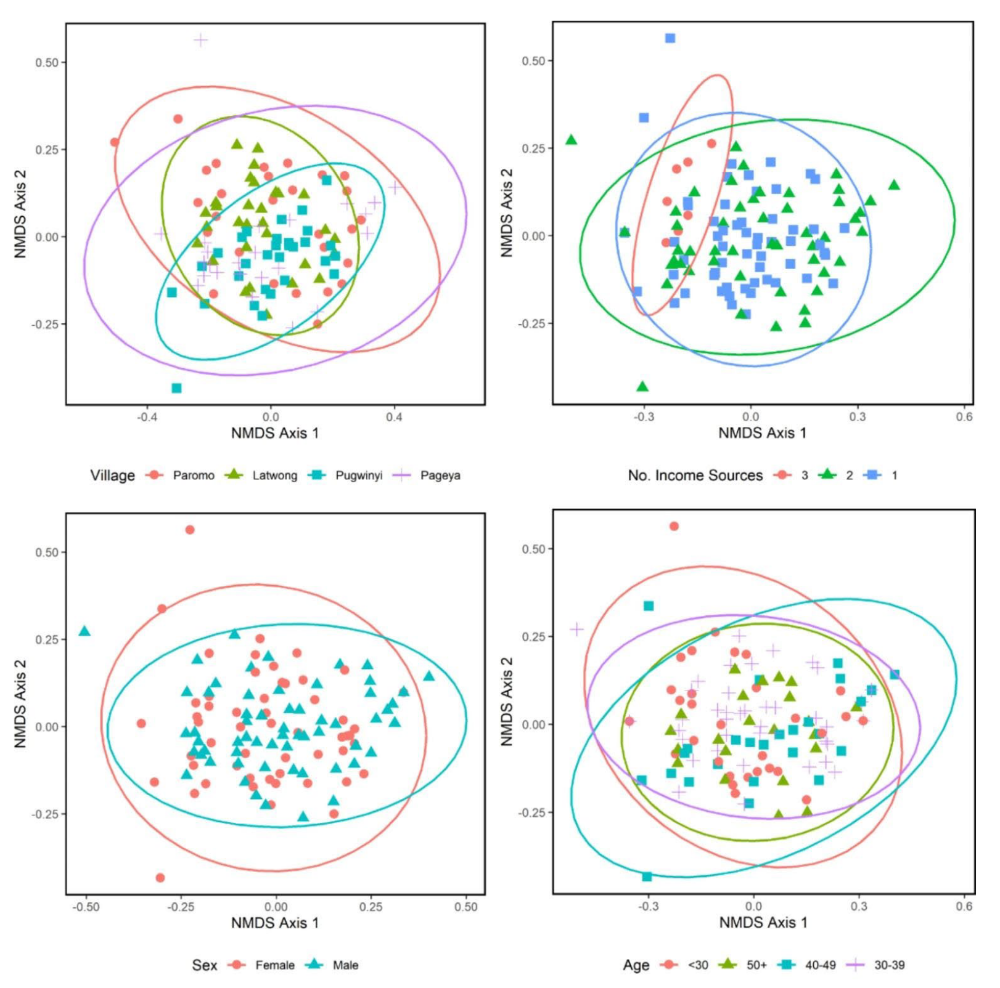
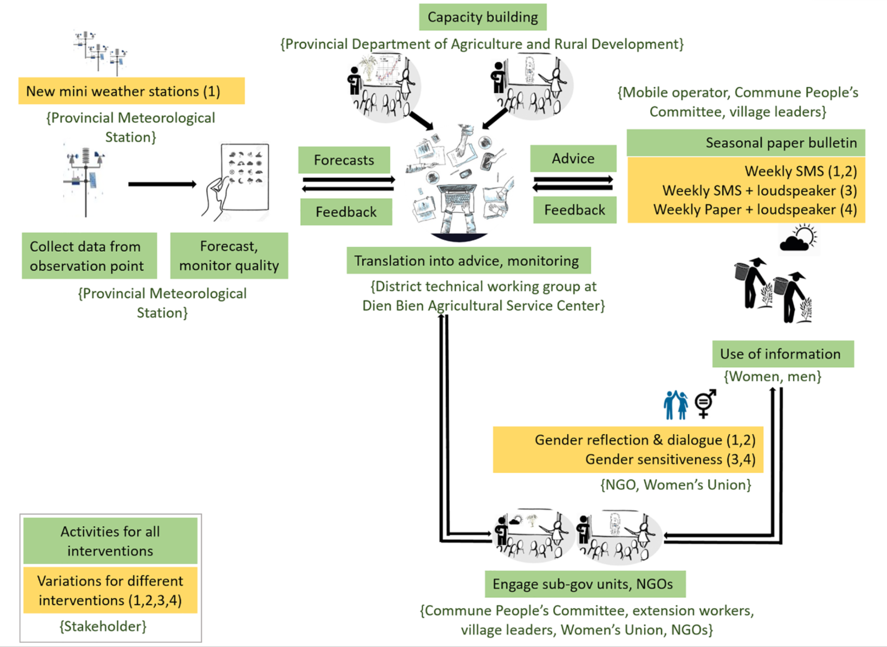

Agroecological transitions require inclusive and participatory approaches to ensure that interventions are effective, scalable, and aligned with local realities. Many policies and models fail to integrate farmer knowledge, Indigenous perspectives, and community-driven adaptation strategies, leading to interventions that lack long-term relevance and impact. Conventional expert-driven models often fail to capture context-specific decision factors, making them difficult to implement at the community level. This section explores how participatory modeling and knowledge co-production enhance decision-making, enabling stakeholders to develop actionable and locally grounded strategies.

Decision analysis methods play a crucial role in prioritizing agroecological interventions by accounting for environmental, economic, and social trade-offs. Conventional approaches frequently neglect uncertainty and multi-criteria decision-making, which can result in interventions that fail to balance sustainability with economic viability. By integrating probabilistic reasoning and structured trade-off analysis, we developed decision-support tools that guide sustainable agricultural practices while remaining adaptive to local conditions.

Indigenous knowledge systems provide invaluable insights into biodiversity conservation, soil health, and agroecological resilience, yet they are often marginalized in formal decision models. Many top-down conservation and agricultural policies fail to recognize the ecological significance and practical applicability of Indigenous knowledge, limiting their effectiveness and adoption. To address this challenge, our work integrates Indigenous ecological knowledge into structured decision-support frameworks, ensuring that interventions remain culturally relevant and ecologically sustainable.

By embedding Indigenous conservation strategies and agroforestry practices into probabilistic decision frameworks, we ensure that traditional land-use planning and biodiversity conservation methods inform sustainable agricultural management. Conventional decision models frequently exclude local and Indigenous expertise, limiting their relevance in complex socio-ecological systems. Incorporating expert-elicited probabilities from Indigenous knowledge holders enhances the applicability of decision-support tools, making them more reflective of traditional resource management strategies. The integration of Indigenous knowledge strengthens agroecological interventions by making them culturally appropriate and ecologically sustainable. Studies such as @oluoch_indigenous_2023 and @tabuti_priority_2022 highlight how local conservation strategies and traditional agroforestry practices can be incorporated into decision models, ensuring that interventions are socially embedded and community-led. 

In @oluoch_indigenous_2023, we employed participatory decision models to capture Indigenous perceptions of wild edible plants, highlighting their cultural, nutritional, and ecological importance. This approach ensured that local resource-use strategies were embedded within conservation planning, aligning scientific models with community priorities. Similarly, in @tabuti_priority_2022, we applied structured frameworks to assess community-led conservation of woody species, demonstrating how Indigenous land-use practices contribute to biodiversity conservation and sustainable agroforestry management. We explored the diversity and uses of woody species in Awach Sub-county, Uganda, through a participatory research approach that actively involved local people in the study process. We conducted household interviews with randomly selected informants, ensuring that a broad range of perspectives was included. By applying exploratory quantitative ethnobotany analysis, we captured both the material contributions and cultural significance of 64 multipurpose tree species valued by the community.

This participatory approach allowed us to document the values for which local people maintain and protect woody species, offering insights into their ecological and socio-economic importance. Informants shared knowledge on tree management, challenges such as pests, diseases, and infrastructure limitations, and strategies for sustainable species use. The engagement of local stakeholders was central to identifying policy mechanisms that support tree establishment and conservation in the region and across sub-Saharan Africa.

To further analyze differences in tree species preferences along socio-demographic gradients, we ran Nonmetric Multidimensional Scaling (NMDS) ordination as an additional exploratory tool (Fig. \ref{fig:tabuti_priority_2022_NMDS}). This approach helped visualize how preferences varied based on factors such as income sources, village of origin, sex, age, and household size. We tested for differences using Permutational Multivariate Analysis of Variance (PERMANOVA), followed by pairwise comparisons. These methods provided deeper insights into the social dimensions of tree use and conservation decisions within the community. By integrating participatory research with quantitative ethnobotany, our study highlights the importance of local knowledge in shaping sustainable land management strategies. The findings underscore the need for policies that recognize and support community-led conservation efforts, ensuring that local priorities drive reforestation and biodiversity conservation initiatives.

Figure \ref{fig:tabuti_priority_2022_NMDS} shows NMDS and PERMANOVA and pairwise comparisons results for 121 informants in Awach subcounty, Gulu District, Uganda. The figure visualizes preferences for 64 woody species, with a stress value of 0.18.

```{r tabuti_priority_2022_NMDS, echo=FALSE, fig.cap="\\label{fig:tabuti_priority_2022_NMDS}Nonmetric Multidimensional Scaling ordination for tree species preferences based on socio-demographic factors (Tabuti et al., 2022).", out.width='80%'}

```

Participatory methods further enhance the integration of local expertise into agroecological decision-making. The scalability and adaptability of these models are critical for advancing agroecology. In @luu_decision_2022, we investigated the challenges associated with scaling agro-climate services (ACS) in Vietnam, using decision analysis to identify leverage points that improve service adoption. Our study examined how stakeholder engagement could enhance the scalability and effectiveness of these interventions.

Farmers in Vietnam are highly sensitive to climate variability, and the lack of timely, actionable climate-informed agricultural advice leads to significant input and yield losses. Development organizations, including CARE in Vietnam, have provided ACS on a limited scale, advocating for government support in scaling these services. However, a large-scale rollout could strain financial and human resources. Given the inherent uncertainty in weather risks and the benefits of ACS, we applied a decision analysis approach to conduct an ex-ante cost-benefit analysis of four candidate interventions for scaling ACS in Dien Bien District.

A key feature of our approach was the active participation of farmers and local stakeholders in designing and evaluating the interventions. We worked closely with CARE in Vietnam, Dien Bien government staff, and agricultural experts to ensure that decision models captured the realities faced by smallholder farmers (Fig. \ref{fig:luu_decision_2022_model}). Through participatory workshops and structured elicitation processes, farmers contributed their knowledge and experiences, shaping the conceptual models and informing the probabilistic simulations used in our analysis.

Figure \ref{fig:luu_decision_2022_model} illustrates the structure and implementation of ACS interventions, highlighting key activities, stakeholder interactions, and information flows. The black arrows represent the movement of information between stakeholders. Green boxes indicate core activities common to all four interventions, while yellow boxes with numbers specify intervention-specific actions. Stakeholders are identified within winged parentheses to emphasize their roles in the decision-making process

```{r luu_decision_2022_model, echo=FALSE, fig.cap="\\label{fig:luu_decision_2022_model}Overview of Four Agro Climate Service (ACS) Interventions in Dien Bien District, Vietnam (Luu et al 2022).", out.width='80%'}

```

Our results indicated a high likelihood of ACS interventions providing net benefits. Investments in ACS were projected to yield high returns, between 1.45 and 16.02 USD per 1 USD invested. These findings offer a strong foundation for decision-making, advocating for the replacement of deterministic assessments with probabilistic approaches in evaluating complex and uncertain development planning decisions. Importantly, the participatory nature of the research ensured that the decision-support tools developed were both scientifically robust and practically relevant to the communities they aimed to serve.

Stakeholder-driven agro-climate services were shown to improve the design, scalability, and adoption of climate adaptation strategies by aligning interventions with farmers' lived experiences. By combining stakeholder engagement with probabilistic modeling, we identified key barriers to adoption and pathways for improving service delivery. 

In @do_decision_2020 we represented uncertainties in the model by expressing all variables as probability distributions derived from expert assessments. To ensure inclusivity, we designed the expert elicitation process as an iterative, participatory engagement with stakeholders. Calibration training sessions improved the accuracy of uncertainty estimates while integrating diverse perspectives. Unlike conventional expert elicitation, our approach included feedback loops where farmers and stakeholders refined model inputs. Participatory workshops facilitated knowledge co-production, allowing local stakeholders to adjust expert assessments based on lived experience, ensuring alignment with real-world constraints. After training, experts and stakeholders provided 90% confidence intervals and distribution shapes for all input variables. This collaborative approach increased accuracy and fostered trust and ownership over decision models. By embedding participatory elements into probabilistic modeling, we enhanced the relevance, transparency, and legitimacy of decision-support frameworks in agroecological transitions.

By bridging local and Indigenous ecological knowledge with probabilistic decision models, our research supports co-created agroecological solutions that are both scientifically rigorous and socially inclusive. These studies highlight the necessity of integrating Indigenous perspectives into agricultural decision-making to ensure that local priorities and traditional practices inform sustainable food systems.

Beyond probabilistic modeling, our research underscores the importance of stakeholder engagement and participatory knowledge co-production. Many agroecological interventions fail because they do not integrate local expertise or address real-world decision constraints. To overcome this, we develop participatory decision-support frameworks that incorporate expert and stakeholder knowledge into structured probabilistic reasoning, making them more effective in real-world agroecological transitions.

By leveraging expert knowledge, structured probabilistic reasoning, and participatory decision-making, our work advances methods for navigating uncertainty in agroecology. These approaches ensure that decision-support tools align with both scientific principles and the expertise of practitioners, policymakers, and communities, providing actionable insights for sustainable agricultural transitions.

