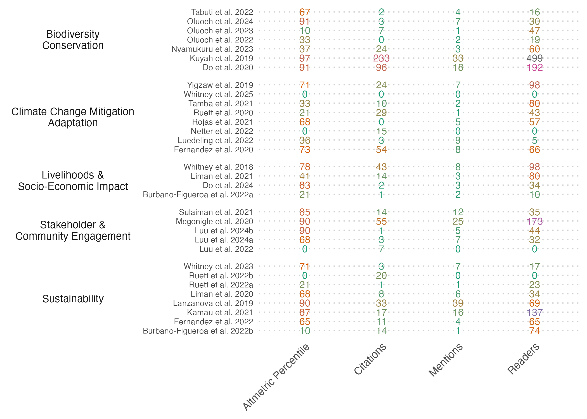

Assessing the real-world impact of research in decision science, agroecology, and environmental policy requires looking beyond academic citations to direct engagement with policymakers, institutions, and practitioners. While much of my work advances methodologies for structured decision-making, several studies have had tangible applications in policy frameworks, agricultural practices, and conservation planning. These impacts are reflected in collaborations with government agencies, NGOs, research institutions, and farming communities across multiple regions.

Structured decision analysis has provided actionable insights for policy formulation and institutional decision-making. Our research on agro-climate services has influenced scaling strategies in Vietnam, with support from CARE International and the Centre for Community Development in Dien Bien [@luu_how_2024; @luu_decision_2022]. These decision models have helped refine government and NGO strategies for delivering climate-informed agricultural advisory services to smallholder farmers.

Research on sustainability trade-offs in banana production has directly shaped policy recommendations within the Action Alliance for Sustainable Bananas (ABNB), facilitated through GIZ (Deutsche Gesellschaft für Internationale Zusammenarbeit). These findings have been integrated into standard guidelines for sustainable banana farming [@fernandez_prioritizing_2022]. 

My work has also directly engaged government agencies and policymakers. Studies on agrobiodiversity and land-use and argicultural development trade-offs have contributed to discussions on sustainable resource allocation and food system resilience in Uganda’s National Planning Authority (NPA), the Ministry of Agriculture, Animal Industry and Fisheries (MAAIF), and the Office of the Prime Minister [@whitney_probabilistic_2018].

Several studies were developed in collaboration with CGIAR (Consultative Group on International Agricultural Research) centers, including ICRAF (World Agroforestry), IWMI (International Water Management Institute), and Bioversity-CIAT, contributing to decision-support frameworks for sustainable land use, carbon footprint assessments, and agroecological transitions. Research on agroforestry adoption, carbon sequestration, and farm management was conducted in partnership with CIFOR-ICRAF Vietnam and regional networks. These studies guided farmers in Vietnam and Sub-Saharan Africa in evaluating the trade-offs between agroforestry adoption, carbon markets, and food production [@do_adapting_2024; @kuyah_agroforestry_2019]. Work on stochastic modeling for irrigation planning and water management contributed to CGIAR’s research agenda on climate resilience in agriculture [@yigzaw_stochastic_2019; @tamba_stochastic_2021]. Studies on wild edible plants and their role in food security and climate adaptation were conducted in partnership with Alliance Bioversity-CIAT, particularly in Kenya’s Turkana region [@oluoch_predicted_2024]. Findings supported conservation planning and local food security strategies. Research on carbon footprint models and national-scale sustainability assessments aligned with CGIAR’s Livestock, Climate, and System Resilience (LCSR) Initiative and FAO’s broader sustainability research. This work contributed to livestock emissions modeling and provided insights for evaluating trade-offs between agricultural intensification and climate action [@luedeling_limitations_2022].

Several studies had direct applications in farm-level decision-making, influencing risk management, farm planning, and agroforestry adoption strategies. These applications involved collaborations with farmers, cooperatives, and research institutions, ensuring that structured decision analysis was not just theoretical but applied in real-world agricultural planning. Decision models helped farmers assess cost-benefit trade-offs for infrastructure investments to mitigate extreme weather risks in cherry orchards [@rojas_adapting_2021]. Horticultural Producers in NRW, Germany: Probabilistic models supported disease management and economic risk assessments in ornamental plant production. This research was conducted in partnership with Europlant Canders GmbH, Landwirtschaftskammer Nordrhein-Westfalen, and Forschungszentrum Jülich [@ruett_assessing_2022; @burbano-figueroa_profitability_2022]. Evaluations of voluntary carbon offset projects in Latin America informed investment decisions in reforestation, ensuring that decision analysis frameworks were applied to balance economic and environmental trade-offs [@netter_agroforestry_2022].

My research has also contributed to biodiversity conservation, food security, and the documentation of traditional ecological knowledge, particularly through collaborations with Indigenous communities and smallholder farmers. Research on climate risks and wild edible plants was conducted with community groups in Kenya's Turkana Region, with CIAT and Bioversity International. Findings supported local conservation planning and food security strategies [@oluoch_predicted_2024]. Work on woody species conservation and livelihood resilience was supported by local research institutions and CIFOR-ICRAF in Uganda, ensuring that traditional ecological knowledge was integrated into biodiversity conservation policies [@tabuti_priority_2022]. Studies on farmer perceptions of agroforestry adoption and barriers to climate adaptation in Vietnam were conducted in collaboration with local agricultural agencies and CIFOR-ICRAF Vietnam [@do_adapting_2024; @luu_how_2024].

Figure \ref{fig:plot_altmetric_data} presents key metrics that capture the reach and engagement of selected papers across different thematic areas. These metrics reflect not only academic recognition through citations but also broader engagement in policy, stakeholder involvement, and public discourse. Papers are categorized into five thematic areas: Biodiversity Conservation, Climate Change Mitigation and Adaptation, Livelihoods and Socio-Economic Impact, Stakeholder and Community Engagement, and Sustainability. x-axis shows four key impact metrics: Altmetric Percentile (relative ranking of a paper’s Altmetric Score compared to similar research, aggregated from various online sources, including news articles, blogs, policy documents, and social media), Citations (extracted from Google Scholar), Mentions (total number of online references to a paper across various platforms, including news articles, policy documents and social media), Readers (count of users who have saved the paper in reference management platforms). Each cell contains the value of the corresponding metric. The numbers are color-coded within each metric to highlight relative differences among papers.  

```{r plot_altmetric_data, echo=FALSE, fig.cap="\\label{fig:plot_altmetric_data}Altmetric and citation metrics for selected papers, grouped by thematic area.", out.width='100%'}

```

Beyond academic impact, my research has gained public visibility through outreach, open-access platforms, and direct engagement with non-academic audiences (Fig. \ref{fig:plot_altmetric_data}). At least two studies have been cited in Wikipedia entries related to agroecology and sustainability, demonstrating a contribution to public discourse on climate and food security. Research findings have been disseminated through invited talks, policy workshops, and decision-support training programs for farmers in NRW, Vietnam, and Uganda. These sessions have provided practical tools for decision-making in agroecology, agroforestry, and farm risk management. Many of these studies have directly involved farmers, conservation practitioners, and policy advisors, ensuring that probabilistic modeling and decision analysis frameworks are applied beyond academic research. While these contributions highlight tangible applications, the direct uptake of decision models in policy and practice remains variable. Factors such as institutional constraints, political shifts, and stakeholder priorities influence whether structured decision analysis is fully integrated into real-world decision-making.

Some studies, such as those on climate risk management for cherry orchards and carbon offset strategies, have had clear pathways to adoption. Others, particularly those focusing on probabilistic modeling improvements and uncertainty quantification, remain foundational contributions that require further application through pilot programs, policy initiatives, or stakeholder engagement. Despite these challenges, the research provides a critical framework for structured decision-making, with ongoing efforts to enhance its applicability across agricultural, environmental, and policy contexts.

